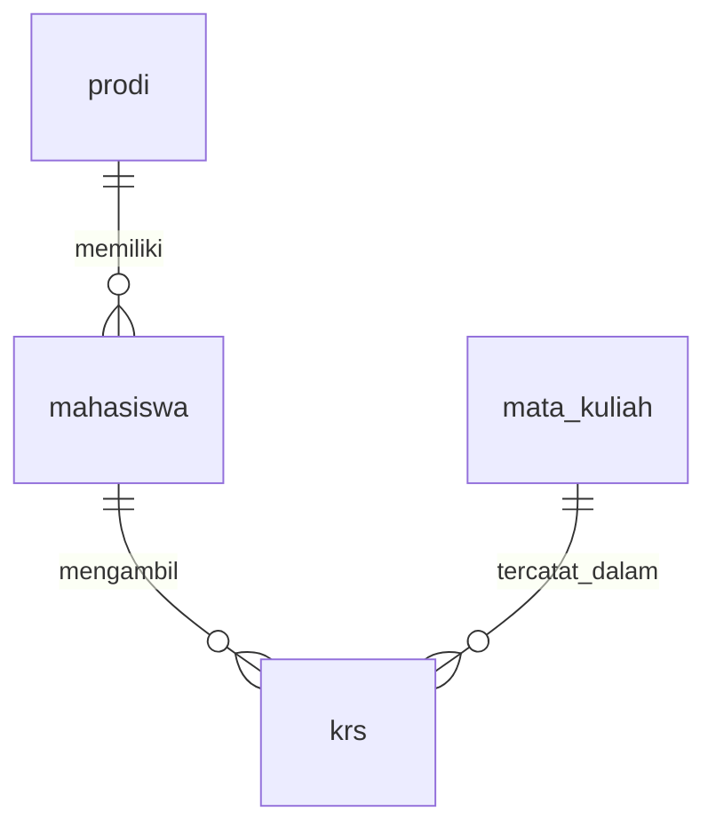

# Data Dictionary dan ERD – Database SIKA

## 1. Daftar Tabel
| Tabel | Fungsi |
|---|---|
| `prodi` | Menyimpan data program studi |
| `mahasiswa` | Menyimpan data mahasiswa |
| `mata_kuliah` | Menyimpan data mata kuliah |
| `krs` | Menyimpan data pengambilan mata kuliah |

## 2. Kamus Data

### 2.1 Tabel `prodi`
| Kolom | Keterangan | Kunci |
|---|---|---|
| `id_prodi` | Identitas program studi | Primary Key |
| `kode_prodi` | Kode program studi | - |
| `nama_prodi` | Nama program studi | - |

### 2.2 Tabel `mahasiswa`
| Kolom | Keterangan | Kunci |
|---|---|---|
| `nim` | Nomor induk mahasiswa | Primary Key |
| `nama` | Nama mahasiswa | - |
| `email` | Alamat email mahasiswa | - |
| `angkatan` | Tahun masuk mahasiswa | - |
| `id_prodi` | Identitas program studi | Foreign Key ke `prodi.id_prodi` |
| `created_at` | Waktu data dibuat | - |

### 2.3 Tabel `mata_kuliah`
| Kolom | Keterangan | Kunci |
|---|---|---|
| `kode_mk` | Kode mata kuliah | Primary Key |
| `nama_mk` | Nama mata kuliah | - |
| `sks` | Jumlah SKS | - |
| `semester` | Semester mata kuliah | - |

### 2.4 Tabel `krs`
| Kolom | Keterangan | Kunci |
|---|---|---|
| `id_krs` | Identitas data KRS | Primary Key |
| `nim` | Identitas mahasiswa | Foreign Key ke `mahasiswa.nim` |
| `kode_mk` | Identitas mata kuliah | Foreign Key ke `mata_kuliah.kode_mk` |
| `tahun_akademik` | Tahun akademik pengambilan mata kuliah | - |
| `semester_ambil` | Semester pengambilan mata kuliah | - |

**Catatan:** Tipe data dan aturan NULL/NOT NULL perlu dicocokkan dengan struktur tabel aktual di MariaDB; rincian tipe data tidak tercantum pada bahan laporan.

## 3. Entity Relationship Diagram (ERD)

## 4. Penjelasan Relasi
1. `prodi` ke `mahasiswa`: one-to-many; satu program studi dapat memiliki banyak mahasiswa.
2. `mahasiswa` ke `krs`: one-to-many; satu mahasiswa dapat memiliki beberapa catatan pengambilan mata kuliah.
3. `mata_kuliah` ke `krs`: one-to-many; satu mata kuliah dapat tercatat pada banyak data KRS.
